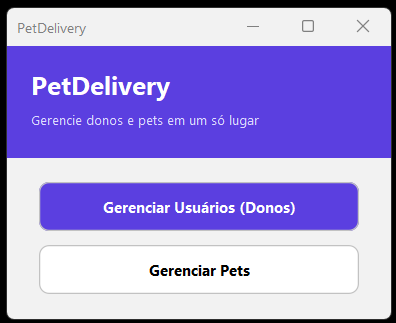
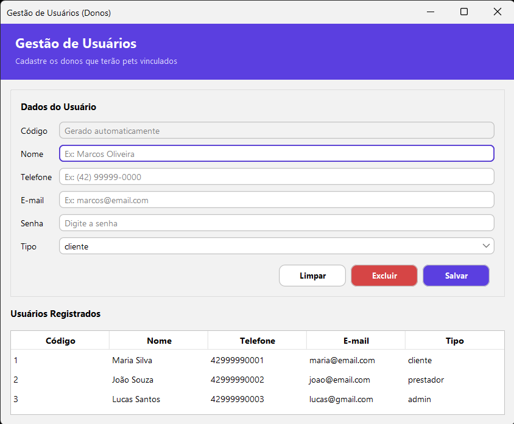
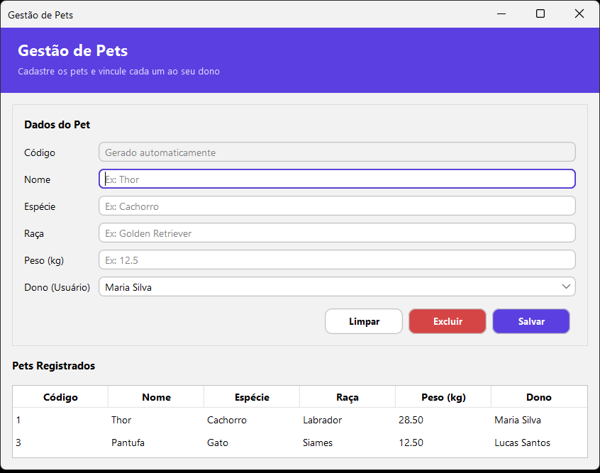

# PETDELIVERY

Sistema desktop em Java para gerenciar donos (usuários) e os pets de cada um, desenvolvido como trabalho de Programação Orientada a Objetos a partir do projeto integrador (startup PetDelivery). A aplicação usa a arquitetura MVC, o padrão DAO e um banco de dados MySQL com tabelas relacionadas.

## Telas


| Menu principal | Gestão de Usuários | Gestão de Pets |
|:---:|:---:|:---:|
|  |  |  |

## Criador

| Nome |
|---|
| Lucas Schneider dos Santos |

## Sobre

O PetDelivery é uma plataforma para donos de pets, com serviços (banho e tosa, veterinário), loja de produtos, pedidos e entregas. O banco de dados (`petdelivery.sql`) representa o modelo completo da startup com 16 tabelas.

Esta entrega implementa o CRUD completo de duas tabelas relacionadas:

| Tabela | Papel | Operações |
|---|---|---|
| `usuario` | Dono do pet (tabela mae) | Criar, listar, atualizar e excluir |
| `pet` | Pet pertencente a um usuário (tabela filha) | Criar, listar, atualizar e excluir |

Relacionamento: `usuario (1) ──── (N) pet`, ligados pela chave estrangeira `pet.id_usuario`, com `ON DELETE CASCADE`, ou seja, ao excluir um usuário, os pets dele também são excluídos.

As demais tabelas do script fazem parte do modelo da startup e não têm telas nesta versão.

## Arquitetura MVC + DAO

- **Model:** mantem os dados de `Usuario` e `Pet`.
- **View:** telas em Java Swing com visual FlatLaf. Exibem dados e capturam o que o usuário digita.
- **Controller:** recebe as ações da View (salvar, excluir, selecionar), valida os dados e chama o DAO.
- **DAO:** únicas classes que falam com o banco, usando `PreparedStatement`.

## Tecnologias e bibliotecas usadas

| Item | Tecnologia |
|---|---|
| Linguagem | Java (JDK 17 ou superior; desenvolvido com JDK 27) |
| Interface gráfica | Java Swing |
| Visual (Look and Feel) | [FlatLaf](https://www.formdev.com/flatlaf/) |
| Banco de dados | MySQL 8 |
| Acesso ao banco | JDBC com `PreparedStatement` |
| Driver | MySQL Connector/J |
| IDE | IntelliJ IDEA |
| Versionamento | Git e GitHub |

## Instalação

### Pré-requisitos

- JDK 17 ou superior instalado
- MySQL Server 8 e MySQL Workbench instalados e com o servidor rodando
- IntelliJ IDEA (ou outra IDE Java)

### Passo a passo

1. Clone o repositório
   ```bash
   git clone https://github.com/p-vg/petdelivery_poo
   ```

2. Crie o banco de dados. Abra o MySQL Workbench, conecte no servidor (`localhost:3306`), abra o arquivo `petdelivery.sql` (*File → Open SQL Script*) e execute tudo (ícone do raio).
   > O script começa com `DROP DATABASE IF EXISTS petdelivery;`. Ao rodá-lo, o banco é apagado e recriado, e os dados existentes são perdidos. apos o primeiro uso, remova essa linha

3. Abra o projeto no IntelliJ IDEA (*File → Open* e escolha a pasta do projeto).

4. Confira as bibliotecas em *File → Project Structure → Libraries*. Os arquivos `.jar` do MySQL Connector/J** e do FlatLaf devem estar listados. Se não estiverem, clique em **+ → Java**, selecione os `.jar` da pasta `lib/` e aplique.

5. Configure a conexão no arquivo `src/Util/Conexao.java`, ajustando URL, usuário e senha para o seu MySQL:
   ```java
   String url = "jdbc:mysql://localhost:3306/petdelivery";
   String usuario = "root";
   String senha = "SUA_SENHA_AQUI";
   ```

6. Execute a classe `Principal.java`. O menu principal abre com os botões **Gerenciar Usuários (Donos)** e **Gerenciar Pets**.

### Solução de problemas

| Erro | Causa provável |
|---|---|
| `Communications link failure` | O MySQL Server não está rodando, ou a porta na URL está errada. |
| `Access denied for user` | Usuário ou senha incorretos em `Conexao.java`. |
| `Unknown database 'petdelivery'` | O script `.sql` ainda não foi executado. |

## Como usar

1. No menu, clique em **Gerenciar Usuários (Donos)** e cadastre um dono (nome, telefone, e-mail, senha e tipo).
2. Volte ao menu, clique em **Gerenciar Pets** e cadastre um pet, escolhendo o dono na lista.
3. Clique em uma linha da tabela para carregar os dados no formulário e **editar** (Salvar) ou **excluir**.
4. Use **Limpar** para começar um novo cadastro.

> Excluir um usuário apaga também os pets dele (`ON DELETE CASCADE`). O usuário Maria Silva, do script de exemplo, possui um pedido cadastrado e não pode ser excluído, porque a tabela `pedido` não tem exclusão em cascata. Para testar a exclusão, crie um usuário novo.

## Transparência de IA

Foi utilizada a ferramenta de IA **Claude (Anthropic)** como apoio. Abaixo, onde e como ela foi usada:

| Parte do projeto | Uso da IA |
|---|---|
| Diagnóstico de erros | Ajudou a identificar a causa do erro `Communications link failure` (servidor MySQL, porta e driver). |
| Ajuda com Controllers e DAOs | Ajudou muito na area de Controllers e DAOs, na qual eu estava meio perdido. |
| Visual da interface | Sugeriu a biblioteca **FlatLaf** e ajudou na criação das telas `MenuView`, `UsuarioView` e `PetView`. |
| Documentação | Ajudou a estruturar este `README.md`. |
